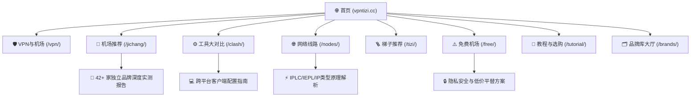

<div align="center">

# 🍀 VPN梯子 (vpntizi.cc)

> **VPN、机场与梯子比较选购指南**  
> 专注网络代理与跨国互联服务的客观实测、底层技术架构对比与权威选购指南。

[](https://astro.build/)
[](https://svelte.dev/)
[](https://www.typescriptlang.org/)
[](https://tailwindcss.com/)
[](https://pagefind.app/)
[](https://vpntizi.cc/)
[](LICENSE)

[🌐 访问正式站点](https://vpntizi.cc/) • [🗂️ 42+ 机场品牌对比大厅](https://vpntizi.cc/brands/) • [📥 客户端官方下载大全](https://vpntizi.cc/posts/client-download-directory/) • [🔬 评测方法论](https://vpntizi.cc/methodology/)

---

</div>

## 📖 项目愿景与定位

**[vpntizi.cc](https://vpntizi.cc)** 旨在打破翻墙网络服务中的**营销信息不对称与虚假宣传**。通过建立标准化的测速探针模型与长期稳定性监控体系，我们为不同层级的用户提供清晰、中立、基于可验证事实的选型决策支持。

全站围绕 **SEO / GEO（生成式引擎优化）/ AEO（回答引擎优化）** 范式打造，深度适配 Google AI Overviews、Perplexity、ChatGPT、Claude 及主流传统搜索引擎。

---

## 🌟 核心特色与技术亮点

### 1. 🛡️ 42+ 活跃机场品牌客观评测数据库
- **全节点晚高峰跑分附图**：深度收录 17+ 家服务商真实 21:00 晚高峰多线程吞吐与丢包率图表。
- **多维交互筛选器**：支持按物理线路（IEPL / IPLC 专线 / 公网隧道 / 直连）、客户端形态（自研专属客户端 / 通用订阅）、解锁属性（原生住宅 IP / 流媒体 4K / ChatGPT 穿透）与月付预算实时筛选。
- **动态防坑预警**：严格标记「待核实」字段，坚决不为商家背书，指导新手严控长期年付风险。

### 2. 🏛️ 8 大业务核心支柱落地页
每个栏目均配备独立的定位说明、适合人群画像、子专题索引、核心横评与 Schema.org 知识图谱：
- [`/vpn/`](https://vpntizi.cc/vpn/)：**VPN与机场** —— 底层协议、OSI分层与接管范围本质差异。
- [`/jichang/`](https://vpntizi.cc/jichang/)：**机场推荐** —— 综合横评、性价比月付套餐与专线精选。
- [`/clash/`](https://vpntizi.cc/clash/)：**工具大对比** —— Clash Verge、v2rayN、Shadowrocket 与专属客户端全方位评测。
- [`/nodes/`](https://vpntizi.cc/nodes/)：**网络线路** —— 直连与中转、IEPL/IPLC 专线原理、机房 IP 与住宅 IP 区别。
- [`/tizi/`](https://vpntizi.cc/tizi/)：**梯子推荐** —— 电脑桌面与手机移动端客户端推荐及长期稳定性监控。
- [`/free/`](https://vpntizi.cc/free/)：**免费机场** —— 公共免费节点安全风险曝光、正规试用核验与低价安全平替。
- [`/tutorial/`](https://vpntizi.cc/tutorial/)：**使用教程与选购指南** —— 客户端下载、订阅导入、分流规则设置、DNS 泄漏检测与避坑指南。
- [`/brands/`](https://vpntizi.cc/brands/)：**机场品牌库大厅** —— 42 家品牌多维参数对比与知识矩阵。

### 3. 🤖 AI 搜索引擎原生优化 (GEO / AEO)
- **Answer-First（答案优先）写作架构**：所有核心章节与文章开头直接输出独立可引用的结论，便于大模型快速提取与引用。
- **全链路 Schema.org 结构化数据**：
  - 首页：`WebSite` + `Organization`
  - 栏目落地页：`CollectionPage` + `BreadcrumbList` + `ItemList` + `FAQPage`
  - 内容详情页：`BlogPosting` + `BreadcrumbList` + `Person`（作者履历）
- **实体识别与语义网络**：以专线类型、加密协议、流媒体风控等实体为纽带，构建稠密高质量的站内内链闭环。

### 4. ⚡ 现代全栈静态工程架构
- **极速构建与轻量交付**：基于 **Astro 7 + Svelte 5**，全站编译为纯静态 HTML 页面（115 个页面构建仅需 20 秒）。
- **Pagefind 毫秒级离线搜索**：无需第三方服务器或外部 API，直接在客户端加载静态索引完成多关键字快速检索。
- **自动化图片与资源优化**：封面图 WebP/AVIF 转换、LQIP（低质量图像占位）预加载、中文字体子集化切片（Font Subsetting）。

---

## 🗂️ 网站架构与内容拓扑



---

## 📁 目录结构导览

```text
vpntizi.cc/
├── public/                 # 静态托管资源（Favicon、图片、robots.txt、sitemap）
│   └── assets/images/      # 机场晚高峰跑分图与测速截图
├── src/
│   ├── components/         # 模块化 UI 组件与 Svelte 交互岛屿
│   │   ├── brands/         # 品牌多维筛选器 (BrandFilter.svelte)
│   │   ├── layout/         # 导航栏、页脚、文章卡片、分类导航条
│   │   └── common/         # 响应式封面图、Markdown 渲染容器
│   ├── config/             # 核心业务与站点配置
│   │   ├── siteConfig.ts   # 基础元数据、站长平台验证位、SEO 关键词
│   │   ├── navBarConfig.ts # 导航菜单与二级集群路径
│   │   └── profileConfig.ts# 作者团队背景与信誉信息
│   ├── content/
│   │   ├── posts/          # 72+ 篇深度原创评测与科普文章 (Markdown/MDX)
│   │   └── spec/           # 页面内容（关于我们、评测方法论、友链）
│   ├── data/               # 结构化品牌数据库 (airports.ts)
│   ├── layouts/            # Astro 布局模板 (Layout.astro, MainGridLayout.astro)
│   ├── pages/              # 语义化页面路由 (/vpn, /jichang, /clash, /nodes...)
│   └── utils/              # URL 规范化、Schema 生成、内容排序工具函数
├── scripts/                # 自动化运维、质量审计与构建后处理脚本
├── astro.config.mjs        # Astro 核心工程配置与插件集成
└── package.json            # 依赖声明与任务指令
```

---

## 🛠️ 本地开发与管理指南

本项目严格使用 [`pnpm`](https://pnpm.io/) 作为包管理器。

### 1. 克隆仓库与安装依赖
```bash
git clone https://github.com/abcabc98698-dev/vpntizi.cc.git
cd vpntizi.cc
pnpm install
```

### 2. 启动本地开发服务器
```bash
pnpm dev
# 默认本地访问地址: http://localhost:4321/
```

### 3. 代码质量与类型校验
```bash
# TypeScript 类型校验（无输出表示全部通过）
pnpm type-check

# Astro 诊断检查（检查所有 Astro/Svelte 模板错误）
pnpm check

# 代码格式化与 Lint 校验
pnpm format
pnpm lint
```

### 4. 生产环境静态打包构建
```bash
pnpm build
```
构建成功后将自动执行：
- 图像 LQIP 计算与 WebP 压缩
- 115 个独立页面静态 HTML 渲染
- 自动生成 `sitemap.xml` 与 `sitemap-index.xml`
- 内联脚本混淆与中文字体切片
- Pagefind 静态全文检索索引生成（输出至 `dist/pagefind`）

### 5. 本地预览生产构建产物
```bash
pnpm preview
```

---

## ⚖️ 合规披露与评测方法论

- **客观中立原则**：所有测速报告与可用率记录均基于真实网络探针（南方电信、华东联通、北方移动）在 20:30~22:30 晚高峰时段实测获取，详见 [评测方法论](https://vpntizi.cc/methodology/)。
- **透明商业声明**：全站所有第三方服务商出站注册链接均严格遵循搜索规范，标注 `rel="nofollow sponsored noopener"`，详见 [推广声明](https://vpntizi.cc/disclosure/)。推广佣金全额用于探针服务器租用与长期带宽测试支出，不影响评测公正性。

---

## 📄 开源许可证

本项目源码基于 [MIT License](LICENSE) 开源发布。内容知识库与文章版权归 [vpntizi.cc](https://vpntizi.cc/) 评测室所有。
